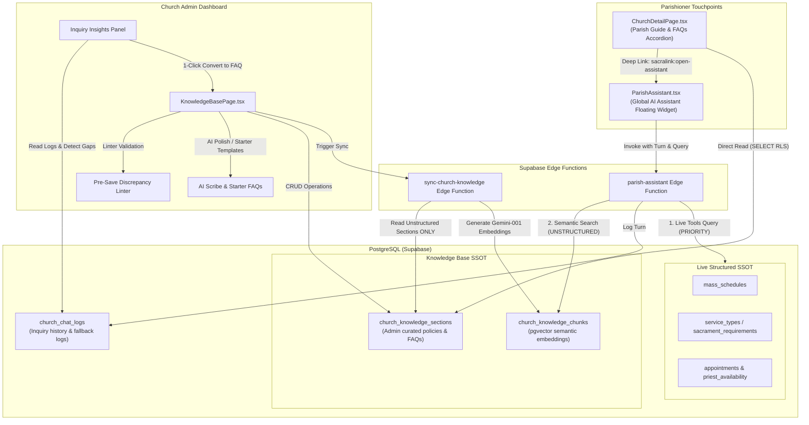

# Feature Spec: Parish Knowledge Base & FAQ Synergy with AI Assistant

**Status:** ready-for-agent  
**Date:** 2026-10-25  
**Effort Directory:** `.scratch/parish-knowledge-base-faq/`  
**Target Integration Branch:** `main` (Release Gate to `feature/demo-mode`)

---

## 1. Executive Summary & Vision

The Sacralink platform empowers Catholic parishes to serve their parishioners both physically and digitally. The AI Parish Assistant (`<ParishAssistant />` and Edge Function `parish-assistant`) is already equipped with live database tools for structured inquiries (e.g., Mass times, sacrament requirements, appointment status, booking drafts). However, parishes require a robust, self-healing knowledge ecosystem where unstructured pastoral guidelines (e.g., dress codes, fiesta celebrations, godparent eligibility, certificate release times, and common parish questions) are seamlessly managed, publicly accessible, and strictly aligned with live database operations.

This feature establishes a **Hybrid Single Source of Truth (SSOT)** architecture:
1. **Live Structured Database Tables** (`mass_schedules`, `service_types`, `appointments`, `sacrament_requirements`) are the authoritative, real-time SSOT for schedules, booking slots, and sacramental offerings.
2. **Knowledge Base Tables** (`church_knowledge_sections` & vector store `church_knowledge_chunks`) are the authoritative source for unstructured pastoral guidelines, parish rules, and FAQs.
3. **Synergy & Inconsistency Prevention**:
   - `sync-church-knowledge` stops embedding recurring Mass schedules into static vector chunks, eliminating stale vector duplication.
   - `parish-assistant` system prompt strictly establishes precedence: live database read tools always supersede vector chunks in case of conflicting information.
   - **Pre-Save Discrepancy Linter**: A client-side regex linter alerts church admins in real time if they attempt to hardcode Mass times or booking fees in free-text knowledge sections.
4. **AI Scribe & FAQ Generator**: Built-in "✨ Polish with AI" (turns rough admin bullet points into warm, reverent pastoral policy) and "✨ Generate Starter FAQs" (5 foundational Catholic parish templates).
5. **Public Parish Profile FAQ Accordion**: A dedicated, searchable "Parish Guide & FAQs" accordion on `ChurchDetailPage.tsx` featuring 1-click deep linking into the floating `<ParishAssistant />`.
6. **Admin Inquiry Insights & Self-Learning**: A chat analytics panel in `KnowledgeBasePage.tsx` reading `church_chat_logs` with a 1-click "Convert Unanswered Question to FAQ" workflow.

---

## 2. Architecture & Data Flow

### 2.1 Hybrid SSOT Architecture Diagram

---

## 3. Detailed Component Specifications

### 3.1 Inconsistency Prevention & Precedence Enforcement
- **Edge Function `sync-church-knowledge`**:
  - Remove chunking and embedding of the `mass_schedules` table. Recurring schedules belong solely to live read queries (`get_mass_schedule` tool in `parish-assistant`).
  - Purge existing `source_type = 'mass_schedule'` records from `church_knowledge_chunks` on sync to clean up legacy chunks.
- **Edge Function `parish-assistant` System Prompt**:
  - Rule explicitly states:
    > "PRECEDENCE & SSOT: Live database tool outputs (`get_mass_schedule`, `find_mass_across_parishes`, `get_bookable_services`, `check_slot_availability`, `get_sacrament_requirements`) are the authoritative Single Source of Truth. If there is ANY discrepancy between live tool data and search_church_knowledge chunks, the live database tool output MUST ALWAYS supersede and be delivered to the user as truth."

### 3.2 Pre-Save Discrepancy Linter (`web/src/utils/knowledgeLinter.ts`)
- Fast, synchronous, client-side regex evaluation executed on input change and pre-save.
- Detects:
  - **Mass Times**: e.g., `/\b(mass|misa)\s+(schedule|time|at)\b/i`, `/\b\d{1,2}(?::\d{2})?\s*(?:am|pm)\s+(?:mass|misa)\b/i`, `/\b(?:sunday|saturday|daily)\s+mass\b/i`.
  - **Booking Fees / Currencies**: e.g., `/(?:₱|php|pesos?)\s*\d+(?:,\d{3})*(?:\.\d{2})?/i`, `/\b\d+\s*pesos?\b/i`, `/\bfee\s*(?:is|:)\s*\d+/i`.
- In `KnowledgeBasePage.tsx`:
  - Renders a warning notification badge above the save action.
  - On clicking "Save", if linter findings exist, displays a confirmation dialog:
    *"We detected hardcoded [Mass schedules / fees] in this section. Mass schedules and fees should be managed in Liturgy and Services tabs to ensure live synchronization. Do you still wish to proceed?"*

### 3.3 AI Scribe & Starter FAQ Generator
- **AI Scribe ("✨ Polish with AI")**:
  - Admin pastes shorthand/draft bullet points into `formContent`.
  - Admin clicks "✨ Polish with AI".
  - Invokes AI assistant endpoint or helper with a dedicated system prompt:
    - Persona: Gentle, welcoming Catholic parish communications director.
    - Transform input into reverent, structured, accessible markdown with clean bullet lists.
    - Preserve all factual constraints, times, and rules without hallucinating.
  - Presents a "Diff / Preview" modal with "Accept Polish" and "Discard" actions.
- **Starter FAQs ("✨ Generate Starter FAQs")**:
  - In `KnowledgeBasePage.tsx`, an action button allows admins to populate 5 foundational parish policies:
    1. *Dress Code & Sacred Decorum*
    2. *Baptism Guidelines & Godparent Eligibility*
    3. *Wedding Application & Certificate Turnaround Times*
    4. *Mass Intentions & Office Inquiries*
    5. *Parish Ministries & Volunteer Participation*
  - Admins can preview and insert individual templates or all 5 with default parish-specific placeholders.

### 3.4 Public Parish Profile FAQ Accordion
- In `web/src/pages/churches/ChurchDetailPage.tsx`:
  - New tab or prominent section: **"Parish Guide & FAQs"** (featuring `BookOpen` icon).
  - Fetches `church_knowledge_sections` where `church_id = id` ordered by `display_order`.
  - Real-time client-side search/filter input ("Search FAQs and guidelines...").
  - Accessible accordion component styled with Sacralink tokens:
    - Card: `bg-white border border-border rounded-2xl shadow-2xs`.
    - Accordion header with expand/collapse chevron and topic title.
    - Accordion body rendered with clean markdown typography.
  - **Deep-linking into `<ParishAssistant />`**:
    - Each FAQ card footer contains an action: `"Have questions? Ask Parish Assistant ✨"`.
    - Dispatches a custom window event `window.dispatchEvent(new CustomEvent('sacralink:open-assistant', { detail: { churchId, query: "..." } }))`.
    - `<ParishAssistant />` listens for this event, opens automatically, sets the active parish, and seeds or submits the inquiry.

### 3.5 Admin Chat Insights & Self-Learning FAQ Generator
- In `KnowledgeBasePage.tsx`:
  - Tabbed interface or collapsible side panel: **"Inquiry Insights"**.
  - Fetches recent records from `church_chat_logs` for the admin's church.
  - Analytical breakdown:
    - Total inquiries logged.
    - Flagged unanswered inquiries: Filters for questions where the AI's answer indicated missing knowledge (e.g., contains "office", "contact", "hindi ko po alam", fallback responses, or `sourcesUsed === 0`).
  - **1-Click "Convert to FAQ"**:
    - Clicking the button on any inquiry opens the section editor.
    - Sets `formTitle` to the parishioner's question.
    - Prompts the AI Scribe to suggest a comprehensive answer draft based on church context, ready for admin review and approval.
    - Saving automatically triggers knowledge sync, closing the knowledge loop.

---

## 4. Design System Compliance & Aesthetics

The UI for all components adheres strictly to the **Sacralink Design System** (`AGENTS.md`):
- **Light Mode Default ("Apple meets The Vatican")**: Clean, crisp, neutral backgrounds (`bg-background` `#F8FAFC`, `bg-white`).
- **Brand Colors**:
  - Faith Blue (`#2563EB` / `bg-primary`, `text-primary`) for primary actions and deep links.
  - Sacred Gold (`#F59E0B` / `text-amber-600`, `bg-amber-50`, `border-amber-300`) for AI highlights, badges, and spark icons.
  - Stone Gray (`#64748B` / `text-secondary-600`, `bg-secondary-50`) for borders, secondary buttons, and metadata.
- **Card Containers**: Standard `.card` class or `bg-white border border-border rounded-2xl shadow-sm`.
- **Zero Dark-Only Hardcoded Styles**: No un-themed `bg-slate-900` or `text-slate-100`.

---

## 5. Security & Permission Considerations

1. **Row Level Security (RLS)**:
   - `church_knowledge_sections`: Publicly readable by all users (authenticated and anonymous) via existing RLS; writable only by `super_admin` and `church_admin` assigned to that `church_id`.
   - `church_chat_logs`: Admins can read chat logs for their assigned church (`Admins can read all chat logs` policy). Parishioners only read their own.
2. **Rate Limiting & Token Budget**:
   - AI Scribe invocations are rate-limited per user session to prevent abuse.
   - Embeddings generation in `sync-church-knowledge` continues to use `text-embedding-001` with chunk size limits (max 500 characters, 100 character overlap).

---

## 6. Implementation Tickets Overview

| Ticket | Slug | Title | Primary Files |
|---|---|---|---|
| 01 | `01-knowledge-sync-and-precedence` | Streamline Knowledge Sync & Enforce Tool Precedence | `supabase/functions/sync-church-knowledge/index.ts`, `supabase/functions/parish-assistant/index.ts` |
| 02 | `02-presave-discrepancy-linter` | Pre-Save Discrepancy Linter for Knowledge Base Sections | `web/src/utils/knowledgeLinter.ts`, `web/src/pages/admin/KnowledgeBasePage.tsx` |
| 03 | `03-ai-faq-writing-assistant` | AI Scribe ("Polish with AI") & Starter FAQ Templates | `web/src/pages/admin/KnowledgeBasePage.tsx`, `web/src/lib/supabase/aiScribe.ts` |
| 04 | `04-public-parish-faq-accordion` | Public Parish Profile FAQ Accordion with Assistant Deep Linking | `web/src/pages/churches/ChurchDetailPage.tsx`, `web/src/components/ai/ParishAssistant.tsx` |
| 05 | `05-admin-chat-insights-faq-generator` | Admin Inquiry Insights & 1-Click FAQ Generator from Chat Logs | `web/src/pages/admin/KnowledgeBasePage.tsx`, `web/src/hooks/useChatInsights.ts` |
